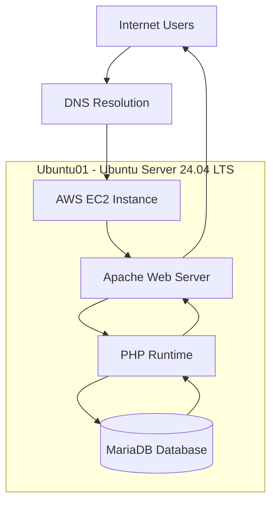

# AWS Ubuntu01 Infrastructure Architecture

## Overview

Conceptual architecture of the Ubuntu01 web server deployed on Amazon Web Services (AWS).

## Architecture Diagram

## Infrastructure Components

| Component | Technology |
|---|---|
| Cloud Provider | Amazon Web Services |
| Compute | Amazon EC2 |
| Operating System | Ubuntu Server 24.04 LTS |
| Web Server | Apache 2.4 |
| Application Runtime | PHP 8.3 |
| Database | MariaDB 10.11 |

## Architecture Description

1. Internet users access the website through a browser.
2. DNS resolves the domain name to the server endpoint.
3. Amazon EC2 provides the virtual server infrastructure.
4. Ubuntu Server hosts the web application environment.
5. Apache handles incoming web requests.
6. PHP processes application logic.
7. MariaDB stores and manages application data.

## Project

**Author:** Samuel Tusevo  
**Organization:** TuseGlobTech  
**Repository:** ubuntu-server-administration
